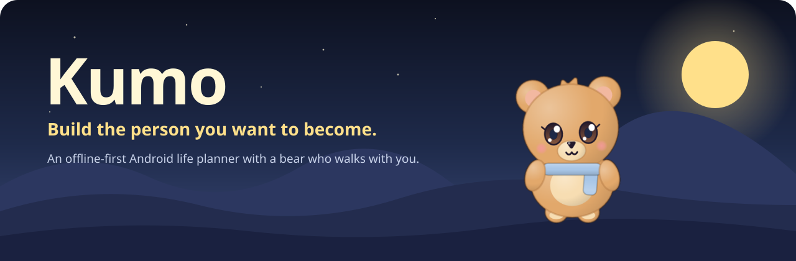
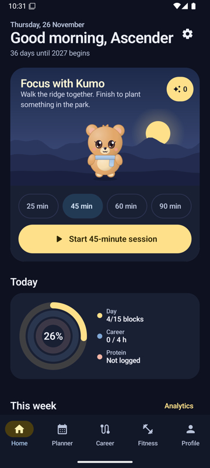
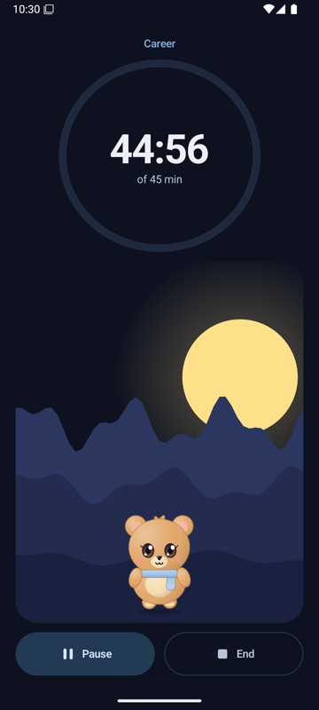
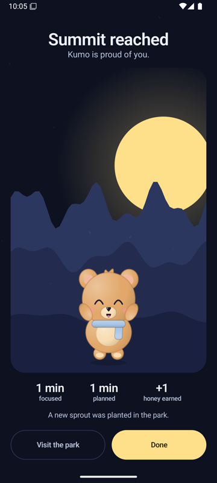
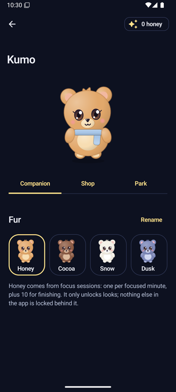
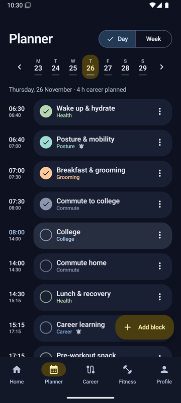
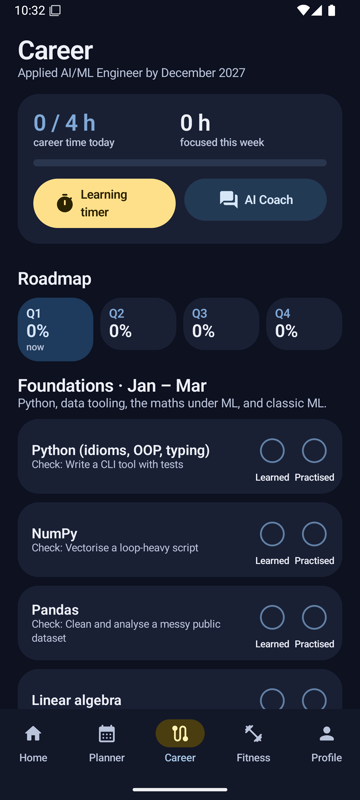
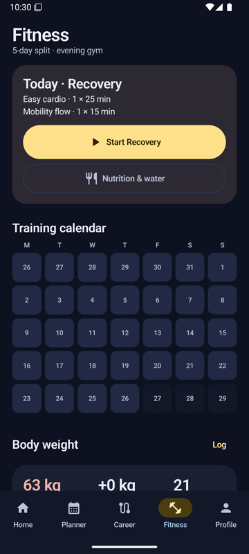
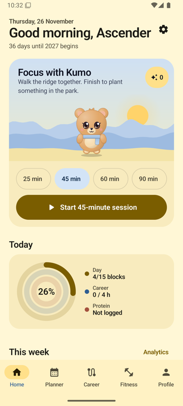

<p align="center">
  
</p>

<p align="center">
  <a href="https://github.com/DivyankLosse/kumo/actions/workflows/android.yml"></a>
  <a href="https://github.com/DivyankLosse/kumo/releases/latest"></a>
  
  
  
  
  <a href="LICENSE"></a>
</p>

<p align="center">
  <b>Plan the day, focus with a friend, and watch the year add up.</b><br>
  A native Android planner for study, career, fitness and habits. No account, no cloud and no invented numbers.<br>
  Kumo, the bear cub, walks a mountain ridge with you while your focus timer runs.
</p>

<p align="center">
  
  
  
  
</p>
<p align="center">
  
  
  
  
</p>

## ✨ Features

| | |
|---|---|
| 🗓️ **Planner that protects sleep** | Mon–Sun templates, day and week views, recurring blocks and reminders. "Reschedule missed" finds the next free slot and never touches 22:30–06:30. |
| 🐻 **Focus with Kumo** | Pick a category and a length; Kumo walks a parallax ridge while the timer runs. Finish to get a summit celebration with confetti, earn honey, and plant something in the park. |
| 🎯 **Career roadmap** | A 4-phase Applied AI/ML plan with milestones, practical checks, coding-problem counts, projects, resources and weekly deliverables. |
| 🏋️ **Fitness** | A 5-day split, set/rep/weight logger with a rest timer, PRs (e1RM), progressive-overload trends, weight and measurements, and private progress photos. |
| 🥗 **Honest nutrition** | Manual entries only. Blank stays blank; Kumo never estimates or invents a number. Water and sleep are tracked here too. |
| 📚 **More modules** | Academics, Communication (speaking timer and voice notes), Grooming, Posture (with a non-medical disclaimer), and Social-confidence challenges. |
| 🔔 **Gentle reminders + widget** | WorkManager reminders with per-type switches, and a Glance "Kumo today" home-screen widget. |
| 🔒 **Yours, offline** | Room + DataStore on the device, one-tap JSON backup and restore, and CSV export. The optional AI Coach talks only to a proxy you run. |

## 📲 Install

Download `kumo-*-debug.apk` from the [latest release](https://github.com/DivyankLosse/kumo/releases/latest), or the `kumo-debug-apk` artifact of any green [CI run](https://github.com/DivyankLosse/kumo/actions). Then install it on Android 8.0+ (allow "install unknown apps" for your browser or file manager).

## 🧭 Roadmap

The honest review and the v1.0.1 plan (onboarding for any schedule, overload advisor, one-tap logging, weekly review, grounded AI coach) are in [docs/ROADMAP-v1.0.1.md](docs/ROADMAP-v1.0.1.md).

---

## Engineering notes

Kumo (renamed from the working title "ASCEND 2027") is a native Android app built with Kotlin and Jetpack Compose: no WebView, PWA, React Native or Expo layers.

## 1. Source
- `app/src/main/java/com/ascend/app/`
  - `domain/`: pure rules: `ScheduleRules` (22:30–06:30 guardrail, free-slot finder), `SeedData` (profile, Mon–Sun planner, 4-phase roadmap, split, exercises, posture moves, prompts), `Metrics`, `Rewards`, `Dates`
  - `data/local/`: Room entities (42 tables), DAOs, `AscendDatabase` (v2), `Migrations`
  - `data/prefs/`: DataStore settings
  - `data/repository/`: repositories (CRUD delegated to DAOs, with domain rules on top) and the first-run `Seeder`
  - `data/backup/`: JSON backup and restore, plus a CSV zip export
  - `data/coach/`: optional AI Coach client (calls the backend proxy only)
  - `work/`: WorkManager reminders and notifications
  - `widget/`: Glance "Kumo today" widget
  - `di/`: manual `AppContainer`
  - `ui/`: `theme` (Dawn Summit tokens, motion), `components` (rings, custom charts, cards), `companion` (Kumo Canvas mascot, ridge, park, confetti), `navigation`, `screens`
- `app/schemas/`: exported Room schemas `1.json` and `2.json`
- `rive/kumo/`: Rive CLI project for the animated mascot (`scene.rml`). Its published output is bundled as `app/src/main/res/raw/kumo.riv`.
- `DESIGN.md` and `PRODUCT.md`: design system and product brief

## 2. Debug APK
CI: every push to `main` builds the APK in GitHub Actions. Download it from the run's **kumo-debug-apk** artifact. Pushing a `v*` tag also attaches it to a GitHub Release.

Local: `app/build/outputs/apk/debug/app-debug.apk` (minSdk 26, target/compile 35)

## 3. Build
Prerequisites: JDK 17 and an Android SDK with platform 36 (compileSdk 36, targetSdk 35, AGP 8.13.2, Gradle 8.13; rive-android 11.x requires compileSdk 36) (`brew install openjdk@17` plus `android-commandlinetools`).
```bash
export JAVA_HOME=/opt/homebrew/opt/openjdk@17/libexec/openjdk.jdk/Contents/Home
echo "sdk.dir=$HOME/Library/Android/sdk" > local.properties
./gradlew :app:assembleDebug                 # APK
./gradlew :app:testDebugUnitTest             # JVM tests
./gradlew :app:connectedDebugAndroidTest     # needs a running emulator/device
```

### Rebuilding Kumo (Rive)
```bash
cd rive/kumo
rive . --verify            # compile check
rive . --screenshot        # headless render to build/kumo.png
rive login                 # once; needed to publish
rive . --publish && cp build/kumo.riv ../../app/src/main/res/raw/kumo.riv
```
The app drives the `Kumo` view model through these properties:
- `pose`: 0 idle, 1 walk, 2 cheer, 3 sleep
- fur colours: `furBase`, `furLight`, `furInner`, `furLine`
- `scarfColor`
- gear booleans: `scarf`, `beanie`, `cap`, `leaf`, `glasses`, `backpack`, `cape`, `headphones`

Kumo falls back to the Canvas bear (`BearCub`) while the file loads, if it fails, under reduce-motion, and in UI tests.

## 4. Database, migrations, export
- **Room** `ascend.db`, schema **v2**, 42 normalized tables with foreign keys (CASCADE) and indexes. Dates are stored as epoch days and times as minutes after midnight.
- **Migration 1→2** (`MIGRATION_1_2`): adds `planned_tasks.priority INTEGER NOT NULL DEFAULT 0` and backfills career blocks to priority 1. `MigrationTest` checks it with `MigrationTestHelper` against the exported `1.json`/`2.json`.
- **Recurring planner:** weekly `task_templates` are copied into concrete `planned_tasks` the first time a day is opened (`materialized_days`). Editing a single day never changes the template.
- **DataStore:** theme, haptics, reminders (master switch and per-type toggles), glass size, rewards toggle, and the coach proxy URL.
- **Backup:** a JSON file with every table (`BackupBundle`, format `kumo-backup`; legacy `ascend-2027-backup` files are still accepted). Restore runs as one transaction that deletes child tables first and inserts parents first, so either everything is replaced or nothing is.
- **CSV export:** a zip containing tasks, focus sessions, workout sets, body weight, measurements, food, water, sleep, roadmap, coding problems, speaking and discomfort.
- Photos and voice notes stay in app-private storage and are **not** included in backups. Android cloud backup is turned off.

## 5. Feature report
| Area | Status |
|---|---|
| Identity: name, tagline, icon, prepopulated editable profile | Done. Renamed to Kumo; the icon is the cub's face. |
| Navigation: 5 tabs with haptics, rail on wide screens, 10 secondary modules | Done |
| Home: greeting, days left in 2027, rings, weekly chart, top 3, schedule, career x/4h, gym, academics, protein, water, sleep, habits | Done |
| Planner: preconfigured Mon–Sun, day/week views, CRUD, complete, skip, reschedule missed, recurring, reminders, focus timer with planned vs actual | Done. The sleep guardrail is enforced in the domain, the repository and the UI. |
| Career: 4 phases, milestones, topics (learned/practised), practical checks, learning timer, coding counts, projects, notes, links, weekly deliverables | Done |
| Fitness: split, library, custom exercises and routines, sets/reps/kg logger, rest timer, PRs (e1RM), overload trend, weight vs 63 kg, measurements, private photos, calendar, history | Done |
| Nutrition: manual-only kcal/P/C/F, meals, water, sleep; blank fields stay blank | Done |
| Academics, Communication (timer, mic requested only when recording), Grooming, Posture (with disclaimer), Social challenges | Done |
| Focus, Companion, Reward: category chips, walking cub on a parallax ridge, celebration (cheer, confetti, honey count-up), park, shop, fur choice, rewards toggle | Done |
| Notifications: morning, career, gym, sunscreen, hydration, posture, night, weekly review, per-task nudges; times are approximate | Done |
| Glance widget, offline-first, analytics (Vico), dark and light themes, reduce-motion | Done |
| Optional AI Coach through a proxy | Client done. The backend proxy is owned by Antigravity and is not built yet. |

## 6. Tests
Last run 2026-11-26: **24/24 JVM unit tests pass, 18/18 instrumented tests pass** on an API 35 arm64 emulator (Pixel-class, 1080×2400). JVM: schedule rules, seed plan (Sunday career is exactly 4h, no blocks inside 22:30–06:30, no overlaps), metrics, rewards, dates, reminder timing, CSV and backup JSON. Instrumented (API 35 emulator): migration 1→2, seeding, task CRUD with the guardrail, reschedule (next day, same day, no-slot), focus points/park/task actual, shop balance, backup restore into a fresh DB, persistence across DB reopen, reminder worker posting notifications (on, off, per-type), UI navigation through every tab and module, and the focus timer.

## 7. Known limitations
- **Rive watermark:** the Rive workspace is on the free plan, so the published `kumo.riv` is watermarked with a Rive splash screen. I didn't see the splash in my emulator captures, but a paid plan is needed to guarantee it never appears.
- **Rive in tests:** UI tests render the Canvas fallback because Rive redraws every frame. Rive was checked on the emulator instead: the log confirms the file loads and properties apply, and screenshots show idle, walk, cheer and the Cocoa recolor.
- **APK size:** the debug APK is about 55 MB because Rive's native libraries ship for every CPU type. Release builds should use an Android App Bundle (AAB), so each phone downloads only its own libraries.
- **Fonts:** Bricolage Grotesque and Figtree load through Google Play services downloadable fonts. On the test emulator, Play services returned "Not found" for these families, so the app fell back to Roboto. Bundling the OFL font files would fix this but needs a download.
- **Default schedule is fully booked:** weekdays run 06:30–22:30 without gaps, so a missed 2h block often has no free slot until the weekend. The app reports "No free slot" instead of overbooking.
- **Focus timer** survives rotation but not process death mid-session.
- Reminders use WorkManager and can be delayed by Doze.
- Backups exclude photos and recordings.
- The AI Coach needs the user's proxy. The expected contract is `POST {url}/v1/coach` with `{messages:[{role,content}], context}`, returning `{reply}`.
- The package id is still `com.ascend.app` (internal only).
- Tested on an emulator only. Gestures and performance still need a real phone.

## License

[MIT](LICENSE) © 2026 Divyank Khewale. Kumo, the character, and its artwork are original to this project.
